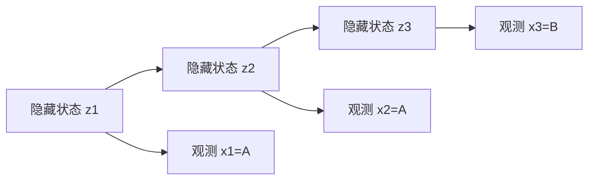

# 隐马尔可夫模型与Viterbi解码

> 更新：2026-10-26；状态：可用；验证范围：官方/原始资料核对；本页标准库Python人工例已执行；未运行生产软件或真实生物数据。

隐马尔可夫模型（hidden Markov model，HMM）描述沿序列变化的隐藏状态，以及每个状态产生的可观测信号。基因组中的状态可代表简化的拷贝数区段或祖源，观测可为深度或碱基；具体生物含义取决于模型。本页用两状态、三个观测区分Viterbi最优路径与前向总概率。

前置为[图与最短路径的生信入门](https://github.com/SpiralKernel/bioinfo-wiki/wiki/%E5%9B%BE%E4%B8%8E%E6%9C%80%E7%9F%AD%E8%B7%AF%E5%BE%84%E7%9A%84%E7%94%9F%E4%BF%A1%E5%85%A5%E9%97%A8)、[动态规划与序列比对基础](https://github.com/SpiralKernel/bioinfo-wiki/wiki/%E5%8A%A8%E6%80%81%E8%A7%84%E5%88%92%E4%B8%8E%E5%BA%8F%E5%88%97%E6%AF%94%E5%AF%B9%E5%9F%BA%E7%A1%80)、条件概率。读完应能说明转移概率和发射概率不同在哪，为什么“最可能路径”不等于每个位置单独选最可能状态。

## 模型的三个概率对象

隐藏状态zt∈{0,…,K−1}，观测xt。初始概率πj=P(z1=j)，转移概率Aij=P(zt=j|zt−1=i)，发射概率bj(xt)=P(xt|zt=j)。一阶马尔可夫假设规定当前状态在给定前一状态后不依赖更早状态；给定状态时观测按指定发射结构产生。

路径与观测的联合概率为$\pi_{z_1}b_{z_1}(x_1)\prod_{t=2}^T A_{z_{t-1},z_t}b_{z_t}(x_t)$。π和A每行概率和为1；连续发射使用的是密度，不能把任意密度值当离散概率。模型与三类任务见[hmmlearn官方教程](https://hmmlearn.readthedocs.io/en/stable/tutorial.html)及[Rabiner经典教程](https://doi.org/10.1109/5.18626)。




横向箭头是状态转移，纵向箭头是当前状态生成观测；这张图表达条件关系，没有画出特定解码路径。

## 求最大和求总和是两个问题

Viterbi定义δt(j)为以状态j结束的最佳联合路径概率：$\delta_t(j)=b_j(x_t)\max_i\delta_{t-1}(i)A_{ij}$，并存使其最大的前驱，末尾选最大δ再回溯。前向算法把max换成∑，计算αt(j)并在末尾求和，得到P(x1:T)。一个是最佳一条路径，一个是所有路径总和，不能混用。

对T位点、K状态，朴素递推时间O(TK²)。记录所有回溯需O(TK)，只求总似然可滚动保存O(K)。长序列概率连乘易下溢，实际常用log域或逐步缩放。

## 两状态三观测的完整核对

设状态L、H初始各0.5，保持原状态概率0.8、切换0.2。观测为A、A、B；L发射A概率0.9，H发射A概率0.2，B为互补概率。第一步δ为0.45、0.1；第二步为0.324、0.018；第三步L为0.02592，H为0.05184，所以最佳路径L→L→H，尽管切换需要代价。

```python
from itertools import product
pi = [.5,.5]
A = [[.8,.2],[.2,.8]]
emission = [{'A':.9,'B':.1},{'A':.2,'B':.8}]
obs = 'AAB'
delta = [pi[j]*emission[j][obs[0]] for j in range(2)]
paths = [[j] for j in range(2)]
for symbol in obs[1:]:
    new_delta, new_paths = [], []
    for j in range(2):
        i = max(range(2),key=lambda h:delta[h]*A[h][j])
        new_delta.append(delta[i]*A[i][j]*emission[j][symbol])
        new_paths.append(paths[i]+[j])
    delta, paths = new_delta, new_paths
best = max(range(2),key=lambda j:delta[j])
def joint(path):
    p = pi[path[0]]*emission[path[0]][obs[0]]
    for t in range(1,len(obs)):
        p *= A[path[t-1]][path[t]]*emission[path[t]][obs[t]]
    return p
all_paths = list(product(range(2),repeat=len(obs)))
print('Viterbi',paths[best],round(delta[best],6))
print('total_observation_probability',round(sum(joint(p) for p in all_paths),6))
assert paths[best] == [0,0,1]
assert abs(delta[best]-max(map(joint,all_paths))) < 1e-12
```

最佳路径联合概率0.05184，全部8条路径概率之和更大。代码用穷举作独立小规模参照，不把枚举当长序列可行实现；正式前向算法避免枚举。 此教学代码还为直观在每步复制完整路径，额外复制成本随路径增长；上面的递推复杂度对应保存前驱再统一回溯的实现，不能把本段教学代码直接当作大规模优化版本。

## 参数如何影响分段

提高自转移概率会使切换更少、更长段，但可能错过短事件；发射分布太宽则观测区分度不足，太窄则噪声可能触发错误分段。基因组位点间距不等时，固定逐位点转移和按物理/遗传距离转移是不同模型，不能直接忽略间隔。

最优路径是一个整体，不提供每位状态置信度；前向-后向可给每位后验，但逐位后验最大化的序列又未必等于Viterbi路径。未知参数可用Baum–Welch等EM策略估计，仍有局部极值、标签交换和模型错设，参见[EM算法与隐变量估计](https://github.com/SpiralKernel/bioinfo-wiki/wiki/EM%E7%AE%97%E6%B3%95%E4%B8%8E%E9%9A%90%E5%8F%98%E9%87%8F%E4%BC%B0%E8%AE%A1)。

## 排错与自测

| 症状 | 检查 |
|---|---|
| 全长只一种状态 | 转移太粘、发射无区分、初始化 |
| 每个位点频繁跳变 | 转移过弱、观测错误、尺度错误 |
| 概率全变0 | 连乘下溢，使用log域/缩放 |
| 解码路径非法 | 回溯索引、零转移是否被尊重 |

**问：δ最大值就是P(观测)吗？** 答：不是，只是一条最佳路径的联合概率。**问：状态叫“缺失”就证明真实缺失吗？** 答：不证明，要看发射证据、倍性、可比对性与独立验证；连接[CNV深度校正分段与拷贝数估计](https://github.com/SpiralKernel/bioinfo-wiki/wiki/CNV%E6%B7%B1%E5%BA%A6%E6%A0%A1%E6%AD%A3%E5%88%86%E6%AE%B5%E4%B8%8E%E6%8B%B7%E8%B4%9D%E6%95%B0%E4%BC%B0%E8%AE%A1)理解实际应用。

本页Python代码在项目根目录执行，仅用标准库且只打印结果，不生成文件；Windows用`python`，macOS/Linux可用`python3`。学习顺序见[方法与算法系统学习指南](https://github.com/SpiralKernel/bioinfo-wiki/wiki/%E6%96%B9%E6%B3%95%E4%B8%8E%E7%AE%97%E6%B3%95%E7%B3%BB%E7%BB%9F%E5%AD%A6%E4%B9%A0%E6%8C%87%E5%8D%97)。


## 运行本页的完整小例

先下载项目并进入含README与examples的根目录，环境准备见[方法与算法系统学习指南](https://github.com/SpiralKernel/bioinfo-wiki/wiki/%E6%96%B9%E6%B3%95%E4%B8%8E%E7%AE%97%E6%B3%95%E7%B3%BB%E7%BB%9F%E5%AD%A6%E4%B9%A0%E6%8C%87%E5%8D%97)。用项目环境的Python运行以下命令（macOS/Linux路径示例；Windows用`.venv\Scripts\python.exe`）：

```bash
.venv/bin/python examples/methods_foundations_demo.py --case hmm --output examples/output/methods-hmm
```

输出summary.json保存本页计算与检查结果。目录非空时拒绝覆盖，再练习请更换`--output`目录；页面内短代码只打印结果。标准库case也可用系统Python直接运行。

公式里的矩阵、下标或对数不熟时，可回查[读懂方法公式的最小数学基础](https://github.com/SpiralKernel/bioinfo-wiki/wiki/%E8%AF%BB%E6%87%82%E6%96%B9%E6%B3%95%E5%85%AC%E5%BC%8F%E7%9A%84%E6%9C%80%E5%B0%8F%E6%95%B0%E5%AD%A6%E5%9F%BA%E7%A1%80)。
